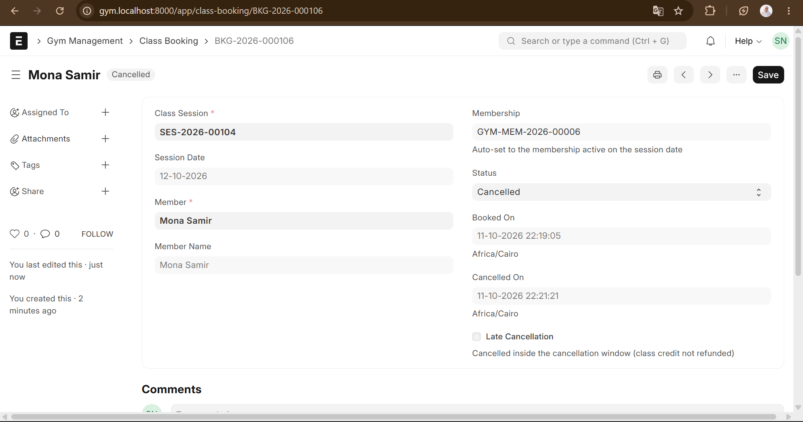

# Gym Management (Frappe / ERPNext v15)

A custom Frappe app, `gym_management`, that runs on top of a standard ERPNext site. It manages
members, membership plans, class scheduling, bookings (with capacity and waitlist) and
check-ins, and **bills through ERPNext** (Customer, Item, Sales Invoice, Payment Entry).

## Install (fresh bench)

Requirements: Ubuntu 22.04, Python 3.10+, Node 18, MariaDB, Redis, `bench` CLI.

```bash
bench init --frappe-branch version-15 frappe-bench && cd frappe-bench
bench new-site gym.localhost --admin-password admin --mariadb-root-password <root-pw>
bench get-app --branch version-15 erpnext
bench --site gym.localhost install-app erpnext
# complete the ERPNext setup wizard in the browser once (creates the Company, chart of accounts, price lists)

bench get-app <path-or-git-url-of-this-repo>          # or: bench get-app /path/to/gym_management
bench --site gym.localhost install-app gym_management
bench --site gym.localhost migrate
bench use gym.localhost && bench start
```

Optional sample data (plans, rooms, trainers, classes, members, a week of sessions):

```bash
bench --site gym.localhost execute gym_management.seed.run
# no chart of accounts yet?  ->  ... execute gym_management.seed.run --kwargs "{'create_invoices': 0}"
```

Open **Gym Management** in the desk. Useful routes: `/app/gym-dashboard`, `/app/gym-checkin`,
`/app/class-session/view/calendar`, `/app/query-report/Membership Expiry Report`.

## Run the tests

```bash
bench --site gym.localhost set-config allow_tests true
bench --site gym.localhost run-tests --app gym_management
```

Needs a site on which the ERPNext setup wizard has been completed (a Company must exist).
Most tests bypass invoicing via `frappe.flags.gym_skip_invoice`; `TestInvoice` exercises the
real Sales Invoice path and skips itself when accounting is not ready.

## What is where

| Area | Location |
|---|---|
| 11 DocTypes (+2 helpers: `Gym Specialty`, `Gym Trainer Specialty` for the multi-select) | `gym_management/gym_management/doctype/` |
| Membership lifecycle, freeze, renew, idempotent invoicing | `doctype/gym_membership/gym_membership.py` |
| Capacity, waitlist, credits | `doctype/class_booking/`, `booking.py`, `utils.py` |
| Scheduled jobs (daily expiry, reminders, auto-renew; hourly "completed") | `tasks.py` |
| Whitelisted API (`book_class`, `get_available_sessions`, ...) | `api.py` |
| Script Report | `gym_management/report/membership_expiry_report/` |
| Dashboard / front-desk pages, workspace | `gym_management/page/`, `gym_management/workspace/` |
| Roles, custom fields, item group | `install.py` |
| Decisions (R1-R5) | `DECISIONS.md` |

## Roles

* **Gym Manager** - everything, incl. cancel/amend and the dashboard.
* **Front Desk** - members, selling memberships, bookings, check-ins.
* **Trainer** - sees only the sessions (and their bookings) of the Gym Trainer linked to their user's Employee, and may only mark *Attended / No Show*.

## Assumptions

* End date is inclusive: a 1-month plan starting 1 Jan ends 31 Jan; freeze days are added to it.
* A *Class Pack* expires after the plan's `validity_days` (default 90); the pack size is `classes_included`, or `duration_value` when that is 0.
* "One active membership at a time" = no two submitted memberships of a member may overlap in dates. Renewals start the day after the current one ends.
* A class credit is taken when a booking becomes *Booked* (waitlisted bookings take none until promoted). Cancelling before the cancellation window returns it; a late cancel does not. If the gym cancels the session, credits always come back.
* The Sales Invoice is created and submitted with `ignore_permissions` so the front desk can sell without Accounts rights; it is found again through the `gym_membership` custom field on Sales Invoice. Free plans (price 0) create no invoice.
* Payments are recorded with ERPNext's Payment Entry (button *Create > Payment Entry* on the membership).
* Contact details are created once as an ERPNext Contact linked to the Customer; later edits are not synced back.
* Reminders and waitlist notifications are e-mails queued with `frappe.sendmail` (needs an outgoing e-mail account to actually leave the server).

## Bonus features

* **Workout plans & body measurements** - `Workout Plan` (a member's plan with a day-by-day exercise table; one Active plan per member) and `Body Measurement` (weight, height, body fat, circumferences; BMI is calculated).
* **Door-controller REST API** - `gym_management/door_api.py`: `check_access` (POST; answers allow/deny with a reason and records a Gym Check In; repeated scans within 60 seconds count as one visit; exit is always allowed) and `get_active_members` (everyone allowed right now, for controllers that work offline). Authenticate with the API key/secret of a user that has the Front Desk role: `Authorization: token <key>:<secret>`.

Run `bench --site <site> migrate` after pulling (new DocTypes).

## Not Done

The member web portal and WhatsApp reminders were not implemented (SMS is supported through Frappe's SMS Settings).


## Screenshots

### Gym Dashboard


### Check-in

| Check-in 1 | Check-in 2 |
|---|---|
|  |  |

| Check-in 3 | Check-in 4 |
|---|---|
|  |  |

### Class Booking

| Class Booking 1 | Class Booking 2 |
|---|---|
|  |  |

| Class Booking 3 | New Class Booking |
|---|---|
|  |  |

### Membership Freeze

| Freeze 1 | Freeze 2 |
|---|---|
|  |  |


### Cancelled Booking



### Workout Plans

| Workout Plan 1 | Workout Plan 2 |
|---|---|
|  |  |

### Body Measurements

| Body Measurement 1 | Body Measurement 2 |
|---|---|
|  |  |


### Gym Member


### Trainer Availability


### Personal Training Sessions

| Personal Training Session 1 | Personal Training Session 2 |
|---|---|
|  |  |

### SMS Notifications

| SMS Notifications 1 | SMS Notifications 2 |
|---|---|
|  |  |

### Door Access API


## Project Demo Video

Watch the project demonstration video:

[**Watch Gym Management Demo on Google Drive**](PASTE_GOOGLE_DRIVE_LINK_HERE)
